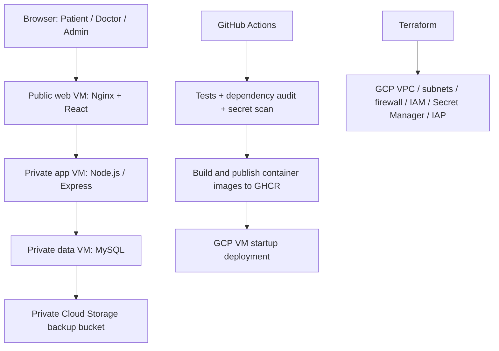

# CareBridge — GCP 3-Tier Clinic Platform

## Project positioning

CareBridge is the GCP infrastructure and operations project in this portfolio. It focuses on a role-based clinic application, private network tiers, identity-based administration, managed secret access, backup/restore and repeatable infrastructure provisioning. It is intentionally **not** a Kubernetes platform project.

## Architecture

## Main DevOps evidence

- **Cloud infrastructure:** GCP Compute Engine, custom VPC, three subnet tiers, firewall boundaries, Cloud NAT and static web IP.
- **Access control:** OS Login and Identity-Aware Proxy for admin SSH; no direct internet SSH rule; separate service accounts per tier.
- **Secrets:** Secret Manager with secret-level IAM bindings; startup scripts must not use shell xtrace while expanding secrets.
- **Operations:** private Cloud Storage backup bucket, scheduled database backup script, restore script, health/readiness endpoints and request IDs.
- **Delivery:** GitHub Actions for Node checks/tests, dependency audit, MySQL-backed API smoke test, Docker Compose integration/restore drill, Terraform validation and image publishing to GHCR.
- **Application:** React/Vite, Express, MySQL and role-based Patient/Doctor/Admin flows.

## How it differs from Shipyard

| Shipyard | CareBridge |
|---|---|
| AWS infrastructure and ECR | GCP infrastructure and Cloud Storage / Secret Manager |
| Jenkins pipeline | GitHub Actions workflow |
| k3s Kubernetes, rolling rollout, HPA and PDB | Three-tier VM architecture; no Kubernetes manifests |
| Ansible server configuration | Terraform plus GCP VM startup templates |
| Prometheus, Grafana and Trivy workflow | GCP IAM/IAP/Secret Manager, backup automation, health checks and CI integration tests |
| Generic deployment platform | Healthcare appointment application and GCP network isolation |

Some shared tools such as Docker, Terraform and Node.js are intentional: they demonstrate transferable skills. The projects have different cloud platforms, delivery tooling, infrastructure patterns and operational goals.

## Interview walkthrough

1. Show the VPC/subnet layout and explain why only the web tier has a public IP.
2. Explain firewall flow: Internet → web, web → app, app → database; administration through IAP.
3. Walk through per-tier service accounts and Secret Manager IAM bindings.
4. Demonstrate CI tests, the MySQL-backed smoke test, Compose restore drill and Terraform validation.
5. Explain the nightly Cloud Storage backup and how you would validate restore objectives.
6. Be clear that a successful real GCP deployment must be personally run and evidenced; the repository configuration alone is not proof of a live deployment.

## Resume-ready description (use only after running the workflow yourself)

**CareBridge — GCP 3-Tier Healthcare Appointment Platform** | GCP, Terraform, Docker Compose, GitHub Actions, Secret Manager, Cloud Storage, MySQL

- Defined a three-tier GCP environment with Terraform, separating public web access from private application and database subnets with tier-specific firewall rules.
- Configured per-tier service accounts, Secret Manager access, IAP-based administration and a private Cloud Storage bucket with 14-day retention for scheduled database and doctor-upload backups.
- Added GitHub Actions workflows for backend checks/tests, MySQL-backed API smoke tests, container builds, Compose backup/restore validation, dependency audits and Terraform validation.
- Added a 16-test backend suite; all 16 repository-level tests passed during the local archive audit. Full Docker/CI and live GCP deployment still require execution.

Do not claim successful cloud deployment, zero vulnerabilities, production readiness, cost savings or uptime figures without evidence from an actual run.
